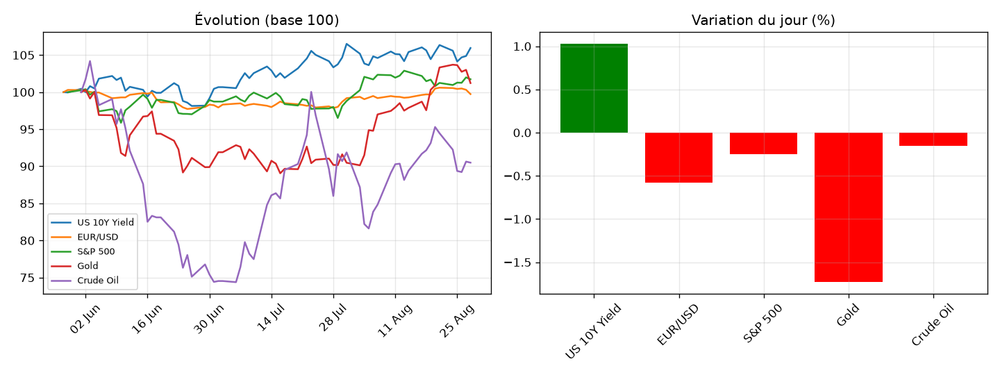

# Market Note — 2026-08-30

## 🔑 En bref
- ⚪ US 10Y Yield +1.03%
- ⚪ EUR/USD -0.58%
- ⚪ S&P 500 -0.25%
- 🔴 Gold -1.73%
- ⚪ Crude Oil -0.16%

## 📊 Graphique du jour

## 🔍 Focus : mouvement(s) notable(s)
**Gold (-1.73%)** — _[à compléter : explication]_

📈 Voir le détail complet (multi-horizons, vol, corrélations)

### Rendements multi-horizons (%)
|              |    1D |    1W |    1M |
|:-------------|------:|------:|------:|
| US 10Y Yield |  1.03 | -0.38 |  1.22 |
| EUR/USD      | -0.58 | -0.86 |  1.05 |
| S&P 500      | -0.25 |  0.49 |  3.69 |
| Gold         | -1.73 | -2.04 | 10.48 |
| Crude Oil    | -0.16 | -4.2  | -0.23 |

### Volatilité annualisée (%)
|              |   Vol annualisée |
|:-------------|-----------------:|
| US 10Y Yield |            13.98 |
| EUR/USD      |             4.56 |
| S&P 500      |            10.63 |
| Gold         |            22.14 |
| Crude Oil    |            42.3  |

### Corrélations (30 derniers jours)
|              |   US 10Y Yield |   EUR/USD |   S&P 500 |   Gold |   Crude Oil |
|:-------------|---------------:|----------:|----------:|-------:|------------:|
| US 10Y Yield |           1    |      0.37 |     -0.29 |  -0.16 |        0.66 |
| EUR/USD      |           0.37 |      1    |     -0.08 |   0.1  |        0.25 |
| S&P 500      |          -0.29 |     -0.08 |      1    |   0.28 |       -0.58 |
| Gold         |          -0.16 |      0.1  |      0.28 |   1    |       -0.06 |
| Crude Oil    |           0.66 |      0.25 |     -0.58 |  -0.06 |        1    |

## 🎯 Vue
Malgré le repli du jour (-1.73%), l'or reste en tendance haussière de fond (+10.48% sur 1 mois). Ce -1.73% ressemble davantage à une prise de 
bénéfices après la forte hausse de la semaine dernière qu'à un retournement de tendance. Je maintiens une vue haussière à 1-2 semaines, tant 
que les craintes sur la dette US restent d'actualité.

Le réel repli à surveiller est plutôt sur le pétrole : -4.2% sur 1 semaine, avec une volatilité annualisée très élevée (42.3%). Cette instabilité rend 
toute vue directionnelle peu fiable à court terme sur cet actif. Je préfère rester à l'écart d'une vue tranchée dessus pour l'instant (US et Trump à surveiller).

Le 10Y US poursuit sa hausse progressive (+1.22% sur 1 mois), cohérent avec un contexte de taux qui restent sous pression.

## ✅ Suivi de la vue précédente
Le 23 août, j'anticipais une poursuite de la tendance haussière sur l'or, sauf apaisement sur le front budgétaire US. Une semaine plus tard, cette 
vue reste globalement valide : la baisse du jour (-1.73%) est modeste au regard du gain cumulé sur le mois (+15.67% le 23 août, encore +10.48% 
aujourd'hui) — pas de signal d'apaisement identifié donc pas de remise en cause de la thèse pour l'instant.

En revanche, je n'avais pas anticipé la baisse marquée du pétrole cette semaine (-4.2%) — à creuser si cela persiste.
