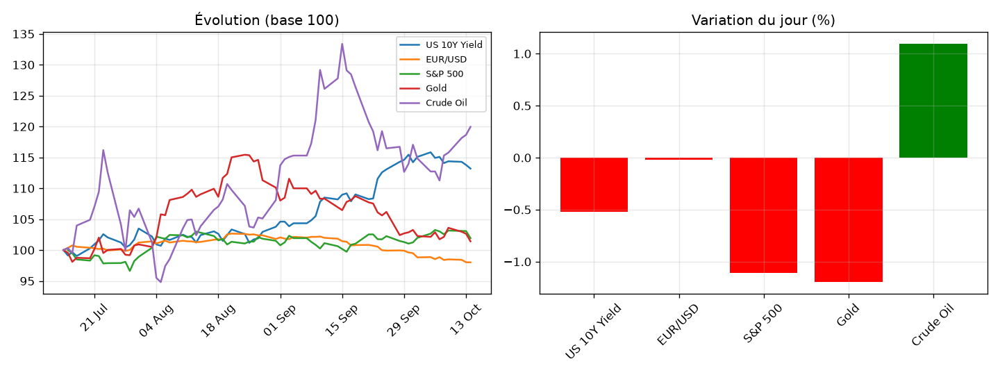

# Market Note — 2026-10-14

## 🔑 En bref
- ⚪ US 10Y Yield -0.52%
- ⚪ EUR/USD -0.02%
- ⚪ S&P 500 -1.11%
- ⚪ Gold -1.20%
- ⚪ Crude Oil +1.09%

## 📊 Graphique du jour

## 🔍 Focus : mouvement(s) notable(s)
Aucun mouvement notable aujourd'hui (seuil : ±1.5%).

📈 Voir le détail complet (multi-horizons, vol, corrélations)

### Rendements multi-horizons (%)
|              |    1D |    1W |     1M |
|:-------------|------:|------:|-------:|
| US 10Y Yield | -0.52 | -1.65 |   3.88 |
| EUR/USD      | -0.02 | -0.85 |  -3.38 |
| S&P 500      | -1.11 | -1.06 |   1.76 |
| Gold         | -1.2  | -0.32 |  -4.74 |
| Crude Oil    |  1.09 |  7.8  | -10.07 |

### Volatilité annualisée (%)
|              |   Vol annualisée |
|:-------------|-----------------:|
| US 10Y Yield |            15.36 |
| EUR/USD      |             4.21 |
| S&P 500      |            10.32 |
| Gold         |            16.8  |
| Crude Oil    |            34.51 |

### Corrélations (30 derniers jours)
|              |   US 10Y Yield |   EUR/USD |   S&P 500 |   Gold |   Crude Oil |
|:-------------|---------------:|----------:|----------:|-------:|------------:|
| US 10Y Yield |           1    |      0.18 |     -0.4  |  -0.38 |        0.05 |
| EUR/USD      |           0.18 |      1    |     -0.23 |  -0.15 |       -0.12 |
| S&P 500      |          -0.4  |     -0.23 |      1    |   0.47 |       -0.45 |
| Gold         |          -0.38 |     -0.15 |      0.47 |   1    |       -0.09 |
| Crude Oil    |           0.05 |     -0.12 |     -0.45 |  -0.09 |        1    |

## 🎯 Vue

Le repli du S&P 500 (-1.11%) vient surtout de la tech (Nasdaq -1.88%, Dow quasi stable) et d'une inflation plus forte qu'attendu, ce qui entretient le scénario d'une Fed plus restrictive. Sur 1 mois l'indice reste en hausse (+1.76%), donc on peut considérer que c'est une correction ponctuelle et non pas une rupture de tendance. 
Je m'attends à de la volatilité sur les valeurs tech à 1-2 semaines, sauf si les prochaines données d'inflation 
rassurent le marché.

La hausse du pétrole reste fortement liée à la géopolitique : frappes des Houthis sur l'Arabie saoudite et attaques sur les pétroliers dans le détroit d'Ormuz. Je vois un biais haussier à court terme tant qu'il n'y a pas de dé-escalade clair, mais avec une vol annualisée de 34.5% et un prix encore -10% sur 1 mois, toute vue directionnelle 
reste fragile.

Un point à surveiller : 
L'or recule de 1.20% sans explication identifiée (-4.74% sur 1 mois) donc à voir s'il s'agit d'une tendance baissière qui s'installe. 

## ✅ Suivi de la vue précédente
_[à compléter manuellement, ou automatisé plus tard]_
